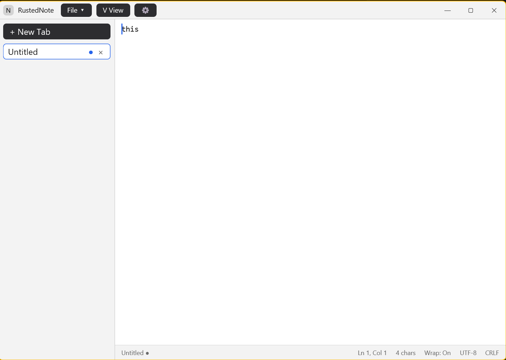
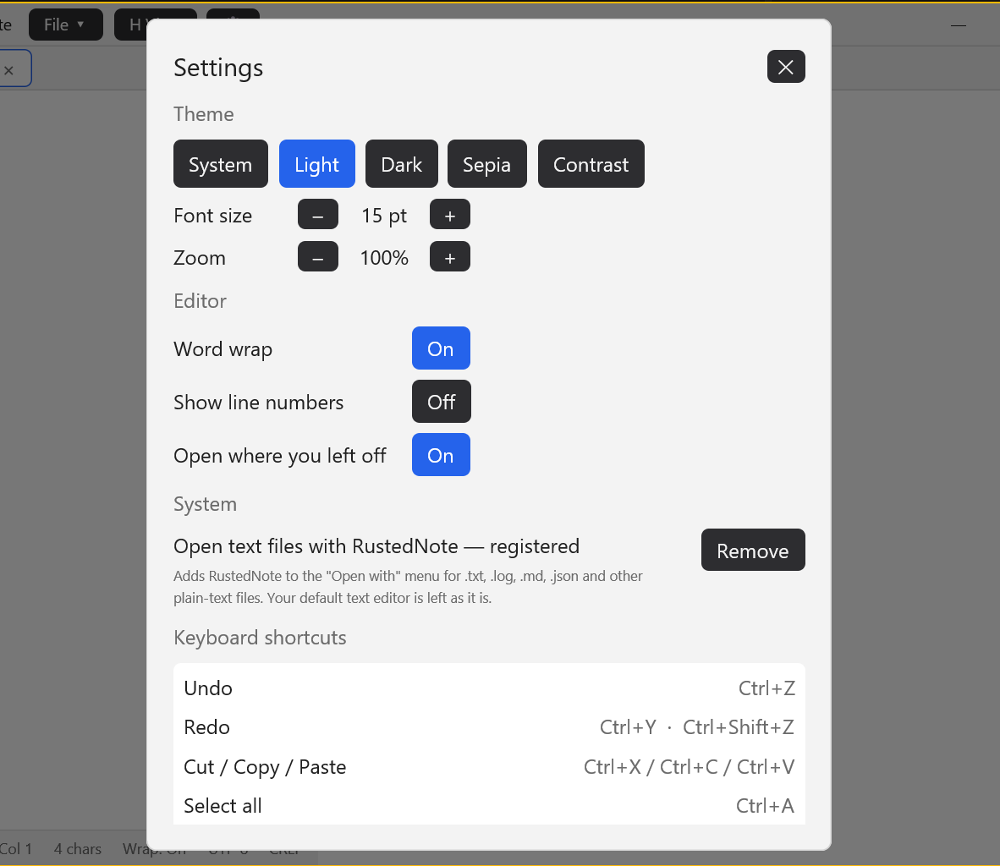
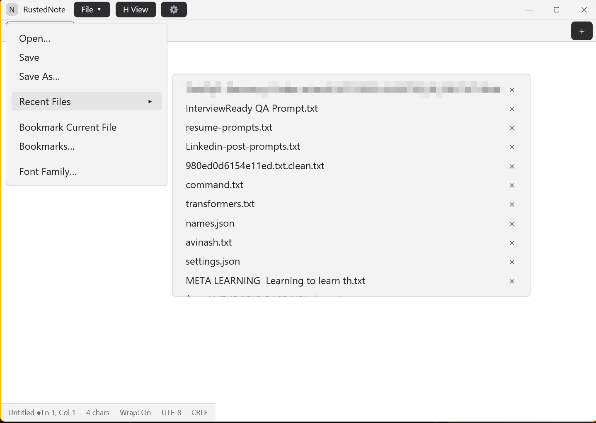
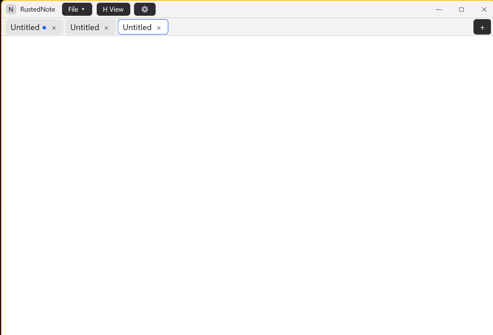

# RustedNote

[](https://github.com/ai-avinashkp/RustedNote)
[](https://www.rust-lang.org)
[](https://gpui.rs)
[](#build--run)
[](PACKAGING.md)
[](LICENSE)

A cross-platform, plain-text notepad built in Rust with **[GPUI](https://gpui.rs)**
(Zed's GPU-accelerated UI framework).

Goal: a fast, comfortable, *plain-text* editor — no syntax highlighting, no
project trees — just great typing ergonomics, eye-comfort themes, custom fonts,
tabs, zoom, and bookmarks.

## Screenshots

**Vertical tabs** — tab list in a sidebar; the blue dot marks unsaved changes.



**Settings** — themes, font size, zoom, word wrap, line numbers, "Open where
you left off", "Open with" registration, and the keyboard-shortcut list.



**File menu** — Open / Save / Save As, a Recent Files flyout (per-item remove),
bookmarks, and font family.



**Horizontal tabs** — the same tabs as a strip across the top (toggle with the
H/V **View** button or `Mod+Shift+L`).



## Feature scope

**Requested**
- Custom **system font** selection (from fonts already installed).
- **Eye-comfort themes** (Sepia/warm, Soft-dark, Light, High-contrast).
- **Pure plain text** — nothing injected into the buffer.
- **Persistent preferences** (`preferences.json`).
- **Ctrl +/- / Ctrl+0** window+text zoom (VS Code-style).
- **Tab manager** with a toggle between **horizontal and vertical** tab strips.
- **Bookmarks** — store references (paths) to `.txt` files in `bookmarks.json`,
  with a simple manager (add / open / rename / remove).

**Recommended additions** (modern-notepad expectations)
- Tier 1: Find & Replace, session restore, dirty-dot + save prompt, word/char
  count, word-wrap & line-number toggles, recent files, `F5` insert date/time,
  drag-and-drop open.
- Tier 2: Command palette (`Ctrl+Shift+P`), focus/distraction-free mode,
  encoding & line-ending switcher, multiple cursors, external-change detection.

## Architecture

```
src/
├─ main.rs        # ✅ App bootstrap, window, keybindings, prefs load → global
├─ app.rs         # ✅ Workspace root: tab strip (horizontal/vertical) + open
│                 #    documents, settings & bookmark overlays, zoom/theme/font
│                 #    actions, Preferences global + prefs/bookmarks persistence
├─ editor/
│  ├─ buffer.rs   # ✅ ropey byte-offset buffer + undo/redo (unit-tested)
│  └─ view.rs     # ✅ multi-line editable view: IME input, cursor/selection,
│                 #    navigation, clipboard, file open/save, status bar;
│                 #    reads theme/font/zoom live from the Preferences global
├─ tabs/mod.rs    # ✅ pure tab-index helpers (unit-tested); entities live in app.rs
├─ prefs/mod.rs   # ✅ Preferences model + zoom/font logic (unit-tested)
├─ theme.rs       # ✅ eye-comfort palettes (raw hex)
├─ fonts.rs       # ✅ enumerate installed fonts (gpui TextSystem)
├─ bookmarks/mod.rs # ✅ Bookmark model + JSON store (wired: Ctrl+D / manager)
├─ integration.rs # ✅ per-user "Open with" register/unregister (Settings → System)
└─ storage.rs     # ✅ config-dir paths + atomic JSON load/save
```

✅ = implemented and (where logic-bearing) unit-tested, GPUI-free.

## Data locations

`directories::ProjectDirs` → per-OS config dir, keyed on the product name
(`RustedNote`) rather than the crate name, so the folder the installer leaves
behind is one users recognize:
- Windows: `%APPDATA%\RustedNote\config\{preferences,bookmarks,recent,session}.json`
- macOS:   `~/Library/Application Support/dev.RustedNote/`
- Linux:   `~/.config/rustednote/`

## Keyboard shortcuts (implemented)

`Mod` = Ctrl on Windows/Linux, Cmd on macOS.

| Action | Keys |
|---|---|
| New / Open / Save / Save As | `Mod+N` / `Mod+O` / `Mod+S` / `Mod+Shift+S` |
| Undo / Redo | `Mod+Z` / `Mod+Y` (or `Mod+Shift+Z`) |
| Cut / Copy / Paste / Select All | `Mod+X` / `Mod+C` / `Mod+V` / `Mod+A` |
| Move caret | Arrows, `Home`, `End` |
| Extend selection | `Shift` + Arrows |
| Newline / Indent | `Enter` / `Tab` |
| Zoom in / out / reset | `Mod+=` (`Mod++`) / `Mod+-` / `Mod+0` |
| Open / close settings | `Mod+,` / `Esc` |
| New tab / close tab | `Mod+T` (or `Mod+N`) / `Mod+W` |
| Next / previous tab | `Ctrl+Tab` / `Ctrl+Shift+Tab` |
| Open file | `Mod+O` |
| Toggle tab layout (horizontal ⇄ vertical) | `Mod+Shift+L` (or the **Layout** button) |
| Bookmarks manager / bookmark current file | `Mod+B` / `Mod+D` |
| Find / Replace | `Mod+F` / `Mod+H` (in bar: `Enter`/`Shift+Enter` next/prev, `Mod+Enter` replace, `Mod+Shift+Enter` replace all) |
| Command palette | `Mod+Shift+P` (`↑`/`↓` to move, `Enter` to run) |
| Focus / distraction-free mode | `F11` (or `Esc` to exit) |
| Cycle theme (System → Light → Dark) | `Mod+Shift+T` (or the **Theme** button) |
| Toggle line ending (LF/CRLF) | click the indicator in the status bar |

## Build & run

Requires the **MSVC** toolchain on Windows (Visual Studio Build Tools, Desktop
C++). Then:

```sh
cargo run            # debug
cargo test           # runs buffer + tab-manager unit tests
cargo build --release
```

> Note: `gpui` pulls a large dependency tree (GPU backends, image codecs), so
> the first build takes several minutes.

## Roadmap

- [x] **Phase 0** — blank GPUI window compiles & runs on Windows.
- [x] **Phase 1** — editable multi-line text: IME input, cursor/selection,
      keyboard navigation, undo/redo, clipboard, file open/save, status bar.
- [x] **Phase 2** — preferences persisted to JSON · live theme switching ·
      system-font picker · font-size control · `Ctrl +/-/0` zoom · settings panel.
- [x] **Phase 3** — multi-document tabs with a horizontal ⇄ vertical toggle ·
      new/close/cycle · open-in-tab · bookmark manager backed by `bookmarks.json`.
- [x] **Phase 4** — Find/Replace · command palette · focus mode · line-ending toggle.
- [x] **Refinements** — custom titlebar (File · H/V View · ⚙ · logo · window
      controls in one slim strip); File menu holds Save/Open, a **hover Recent-Files
      flyout** (per-item remove + Clear All), and Bookmark/Bookmarks; theme + full
      **keyboard-shortcuts list** live in Settings; recent files pruned on startup;
      System/Light/Dark; **responsive** (adaptive titlebar + viewport-fitted overlays).
- [x] **Phase 5** — release build branded **`RustedNote.exe`** with embedded
      icon + version metadata (`build.rs` + `winresource`); see `PACKAGING.md`.

## License

Copyright (c) 2026 Avinash Prajapati.

Licensed under the **[RustedNote Personal Use License 1.0](LICENSE)** — free
for individuals to use for their own private, noncommercial purposes.
**Not permitted:** commercial use, use at work or for an employer, and use by
any company or organization (including nonprofits, schools, and government).
For any of those, contact the author via [GitHub](https://github.com/ai-avinashkp)
for a separate license.
